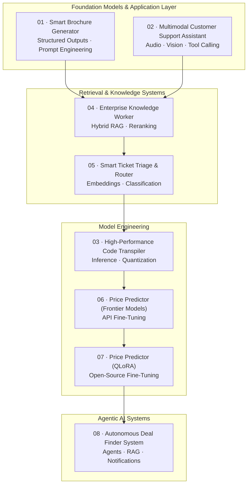

@'
# LLM Engineering Systems

End-to-end LLM Engineering portfolio featuring 8 production-grade applications covering Multimodal APIs, Structured Outputs, Hybrid RAG pipelines, Open-Source Quantization (Hugging Face), and QLoRA Fine-Tuning.

## 🚀 LLM Engineering Systems


[](https://www.python.org/)
[](https://fastapi.tiangolo.com/)
[](https://www.docker.com/)
[](https://github.com/astral-sh/ruff)
[](https://mypy-lang.org/)
[](https://docs.pytest.org/)
[](https://github.com/astral-sh/uv)
[](LICENSE)

> **Production-Grade AI Engineering Portfolio**
>
> A collection of end-to-end LLM systems covering Structured Outputs, Multimodal AI, Retrieval-Augmented Generation (RAG), Model Optimization, Fine-Tuning, Evaluation Frameworks, and Agentic Workflows.

---

## 🎯 Portfolio Vision

Modern AI applications are more than prompts connected to a model.

This portfolio demonstrates how production-grade AI systems are engineered through:

- Prompt Engineering
- Structured Outputs
- Multimodal AI
- Retrieval-Augmented Generation (RAG)
- Embedding Pipelines
- Model Quantization
- Fine-Tuning
- Evaluation Frameworks
- Observability
- Agentic Systems

The goal is not simply to build applications that work.

The goal is to build AI systems that are:

- ✅ Reliable
- ✅ Testable
- ✅ Observable
- ✅ Maintainable
- ✅ Reproducible
- ✅ Production-Ready

---

## 🏛️ Portfolio Architecture

This repository is intentionally structured as a progressive engineering journey, starting with foundation-level LLM applications and culminating in autonomous AI systems.



### Engineering Progression

| Stage | Focus | Projects |
|---------|---------|---------|
| Foundation | Prompt Engineering, APIs, Structured Outputs | 01, 02 |
| Retrieval | Embeddings, Search, RAG Pipelines | 04, 05 |
| Model Engineering | Inference, Quantization, Fine-Tuning | 03, 06, 07 |
| Agentic Systems | Multi-Step Reasoning, Autonomous Workflows | 08 |

---

## 🗺️ Architecture & Projects Roadmap

| # | Project | Domain | Core Technologies | Status |
|:-:|----------|----------|------------------|:------:|
| 01 | **Smart Brochure Generator** | Structured Outputs | OpenAI, Anthropic, Pydantic, Streaming, BeautifulSoup | 🚧 In Progress |
| 02 | **Multimodal Customer Support Assistant** | Multimodal AI | Vision, Whisper, Tool Calling, Gradio | ⏳ Planned |
| 03 | **High-Performance Code Transpiler** | Open-Source Inference | Hugging Face, vLLM, AWQ, GGUF | ⏳ Planned |
| 04 | **Enterprise Knowledge Worker (RAG)** | Retrieval Systems | LangChain, LlamaIndex, Hybrid Search, Reranking, ChromaDB | ⏳ Planned |
| 05 | **Smart Ticket Triage & Router** | Classification Systems | Embeddings, Zero-Shot, Few-Shot Learning | ⏳ Planned |
| 06 | **Price Predictor (Frontier Models)** | Fine-Tuning APIs | OpenAI Fine-Tuning, Evaluation Pipelines | ⏳ Planned |
| 07 | **Price Predictor (QLoRA)** | Open-Source Fine-Tuning | PEFT, LoRA, QLoRA, bitsandbytes, Weights & Biases | ⏳ Planned |
| 08 | **Autonomous Deal Finder System** | Agentic AI Systems | RAG, Agents, Notifications, Fine-Tuned Models | ⏳ Planned |

---

## 🧠 Technology Stack

### Core Engineering

- Python 3.12
- FastAPI
- Pydantic v2
- uv
- Docker

### Foundation Models

- GPT-4o
- Claude 3.5 Sonnet
- Llama 3
- Mistral
- Qwen

### LLM Frameworks

- LangChain
- LangGraph
- LlamaIndex

### Retrieval & Search

- ChromaDB
- Qdrant
- Hybrid Search
- Reranking Pipelines

### Training & Optimization

- Hugging Face Transformers
- PEFT
- LoRA
- QLoRA
- bitsandbytes
- vLLM
- AWQ
- GGUF

### Evaluation & Observability

- Ragas
- DeepEval
- Langfuse
- Weights & Biases

---

## 🏗️ Repository Architecture

```text
llm-engineering-systems/
│
├── projects/
│   ├── 01-smart-brochure-generator/
│   ├── 02-multimodal-support-assistant/
│   ├── 03-code-transpiler/
│   ├── 04-enterprise-knowledge-worker/
│   ├── 05-smart-ticket-router/
│   ├── 06-price-predictor-frontier/
│   ├── 07-price-predictor-qlora/
│   └── 08-autonomous-deal-finder/
│
├── shared/
│
├── docs/
│
└── README.md
```

---

## ⚙️ Engineering Standards

Every project in this portfolio follows the same engineering blueprint.

A project is considered complete only when all quality gates are satisfied.

| Requirement | Target |
|------------|---------|
| FastAPI Backend | ✅ Required |
| Unit Tests | ✅ Required |
| Coverage | ≥ 90% |
| MyPy Strict Mode | ✅ Required |
| Ruff Linting | ✅ Required |
| Docker Support | ✅ Required |
| CI/CD Pipeline | ✅ Required |
| Prompt Versioning | ✅ Required |
| Evaluation Framework | ✅ Required |
| Architecture Documentation | ✅ Required |
| Observability | ✅ Required |

---

## 🚀 Quick Start

### Clone the repository

```bash
git clone https://github.com/gtaltou/llm-engineering-systems.git

cd llm-engineering-systems
```

### Install dependencies

```bash
uv sync
```

### Configure environment variables

```bash
cp .env.example .env
```

---

## 📈 Long-Term Goal

Build a comprehensive collection of production-grade AI systems demonstrating practical expertise across:

- Prompt Engineering
- Multimodal AI
- Retrieval Systems
- Fine-Tuning
- Quantization
- Evaluation
- Agentic Workflows

The objective is to showcase engineering excellence through measurable, reproducible, and maintainable AI architectures.

---

## 🤝 Contributing

Contributions, feedback, and engineering discussions are welcome.

Before submitting a pull request, ensure:

```bash
ruff check .
ruff format --check .

mypy .

pytest
```

All contributions should adhere to the engineering standards defined within this repository.

---

## 📋 License

This project is licensed under the MIT License.

See the [LICENSE](LICENSE) file for details.

---

## 👨‍💻 Author

**Guy TALTOU**

AI Engineering • LLM Systems • RAG Architectures • Agentic Workflows • Fine-Tuning • Production AI Systems

Building reliable, observable, and production-ready AI applications.

---

## ⭐ Support the Project

If you find this repository useful:

- Star the repository
- Share it with other AI engineers
- Follow future releases

Every star helps increase the visibility of the project and supports the open-source journey.

## Local Setup

```bash
git clone https://github.com/gtaltou/llm-engineering-systems.git
cd llm-engineering-systems
uv sync
cp .env.example .env
