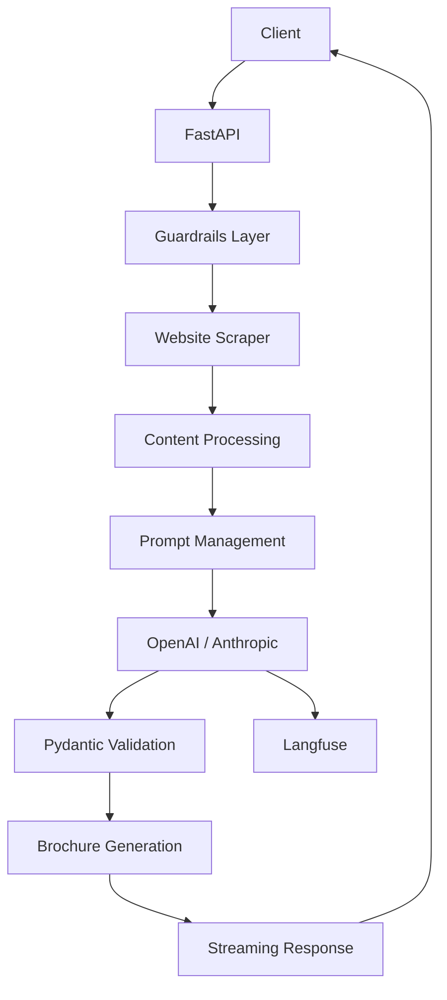

# 📄 Smart Brochure Generator


[](https://www.python.org/)
[](https://fastapi.tiangolo.com/)
[](https://docs.pydantic.dev/)
[](https://github.com/astral-sh/ruff)
[](https://mypy-lang.org/)
[](https://docs.pytest.org/)
[](https://www.docker.com/)
[](../../LICENSE)

> **Production-Grade AI Application**
>
> Transform any company website into a professional AI-generated marketing brochure using structured outputs, validation guardrails, and modern LLM engineering practices.

---

## 🎯 Project Overview

Smart Brochure Generator is designed to demonstrate how modern LLM applications can move beyond simple prompt-response workflows and adopt production-grade engineering standards.

The application:

1. Scrapes a company website
2. Extracts relevant business information
3. Generates structured marketing content
4. Validates outputs through Pydantic schemas
5. Produces a professional brochure

This project showcases:

- Structured Outputs
- Prompt Engineering
- FastAPI
- Data Validation
- Website Scraping
- Streaming Responses
- Evaluation Pipelines
- Testing & CI/CD
- Type-Safe Python

---

## 🎬 Demo

> Demo GIF coming soon

Expected workflow:

```text
Company Website URL
         │
         ▼
 Website Scraper
         │
         ▼
 Content Extraction
         │
         ▼
 Prompt Templates
         │
         ▼
      LLM
         │
         ▼
 Structured Outputs
         │
         ▼
 Brochure Generator
         │
         ▼
     User
```

---

# 🏛️ Architecture



---

## 🧱 Application Architecture

```text
01-smart-brochure-generator/
│
├── .github/
│   └── workflows/
│       ├── ci.yml
│       └── llm_eval.yml
│
├── src/
│   └── smart_brochure_generator/
│       │
│       ├── api/
│       │   ├── main.py
│       │   └── routes.py
│       │
│       ├── agents/
│       │   └── brochure_agent.py
│       │
│       ├── prompts/
│       │   └── brochure.yaml
│       │
│       ├── retrieval/
│       │   └── web_scraper.py
│       │
│       ├── guardrails/
│       │   ├── validators.py
│       │   └── pii.py
│       │
│       ├── schemas/
│       │   ├── brochure.py
│       │   └── company.py
│       │
│       └── config.py
│
├── evals/
│   ├── golden_dataset.json
│   └── evaluate.py
│
├── tests/
│   ├── test_health.py
│   ├── test_config.py
│   └── test_imports.py
│
├── assets/
│   ├── demo/
│   ├── architecture/
│   └── screenshots/
│
├── Dockerfile
├── docker-compose.yml
├── Makefile
├── pyproject.toml
└── README.md
```

---

## ✨ Features

### Structured Outputs

Generate validated brochure sections using Pydantic models rather than unconstrained text.

### Prompt Versioning

Prompts are stored separately from application logic and can evolve independently.

### Provider Agnostic

Compatible with:

- OpenAI
- Anthropic

### Validation Layer

Guardrails validate content before brochure generation.

### Streaming Responses

Real-time generation improves user experience.

### Type-Safe Architecture

Strict typing enforced through MyPy.

### Automated Quality Control

Integrated linting, testing, coverage, and CI/CD pipelines.

---

## 🧠 Engineering Decisions

### Why Structured Outputs?

Traditional prompting often produces inconsistent outputs.

Pydantic schemas improve:

- Reliability
- Predictability
- Validation
- Testing

### Why FastAPI?

FastAPI provides:

- High performance
- Async support
- OpenAPI documentation
- Production readiness

### Why Externalized Prompts?

Prompt versioning allows:

- Reproducibility
- Easier experimentation
- Cleaner architecture

### Why a Dedicated Evaluation Layer?

Every AI application should be measurable.

This project includes an evaluation framework to detect regressions and compare prompt iterations.

---

## 📊 Benchmarks

> Evaluation pipeline under development

| Metric | Result |
|----------|----------|
| Generation Accuracy | TBD |
| Validation Pass Rate | TBD |
| Average Latency | TBD |
| Cost per Request | TBD |
| Hallucination Rate | TBD |

---

## 🔬 Evaluation Framework

```text
evals/
├── golden_dataset.json
└── evaluate.py
```

Goals:

- Measure brochure quality
- Compare prompt versions
- Detect regressions
- Quantify improvements

Future integration:

- DeepEval
- Ragas
- Langfuse Analytics

---

## 🧪 Testing

Run the complete test suite:

```bash
pytest
```

Coverage report:

```bash
pytest --cov=src
```

Linting:

```bash
ruff check .
```

Format validation:

```bash
ruff format --check .
```

Static typing:

```bash
mypy .
```

---

## ⚙️ Quality Gates

A pull